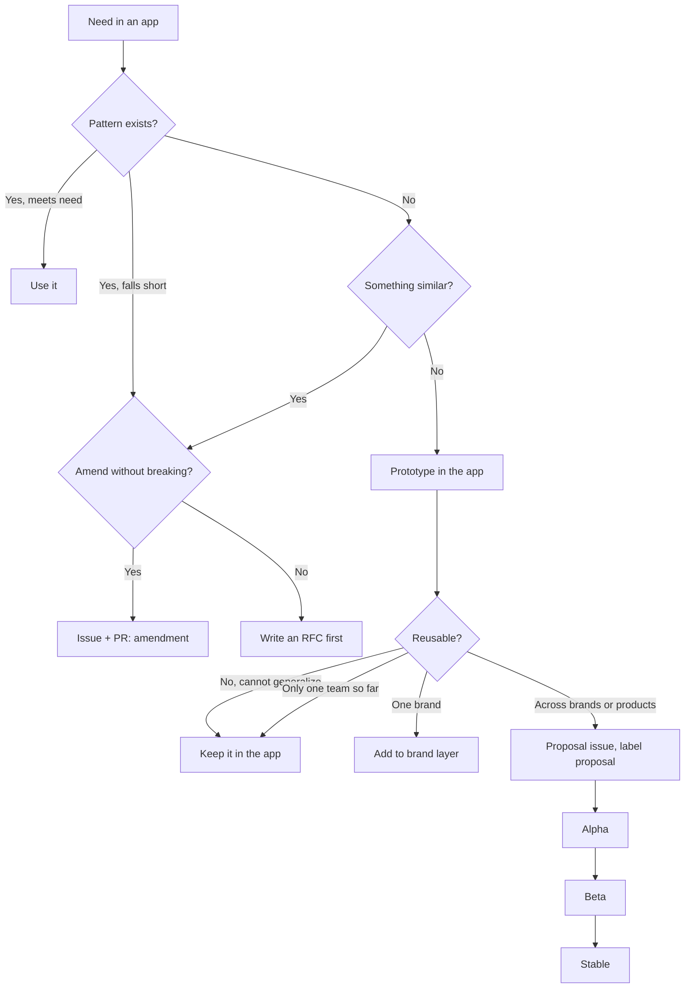

<!--
Copy to design-system/docs/contribution.md.
Replace: <prefix>, <core-team>, <channel>, <tracker-url>, <proposal-label>, <working-group>.
Adapted from Canonical's Vanilla pattern flow in Atomic Design, ch. 5 "Making changes to patterns",
https://atomicdesign.bradfrost.com/chapter-5/ . Brand-layer and RFC steps are beyond the book.
-->

# Contributing a pattern to <prefix>

Use this flow before you build anything new or change a shared pattern. Ask in <channel> if a
step is unclear; <core-team> answers within two business days.

## Decision list

1. **Does a pattern already exist for this need?** Search the library and `lineage.md`.
   - Yes, and it meets the need: use it. Stop.
   - Yes, but it falls short: go to 2.
   - No: go to 3.
2. **Can it be amended without breaking current uses?** Check its "used in" list.
   - Yes: open an issue labelled `amendment` describing the change, then a pull request. Stop.
   - No (the change would break apps): write an RFC (`rfcs/`) before any code. Stop.
3. **Does something similar exist?**
   - Yes: treat it as an amendment of that pattern and go to 2.
   - No: go to 4.
4. **Prototype the concept inside your app**, built from existing tokens and atoms.
5. **Is it reusable beyond your app?**
   - No: can it be made more generic? If not, keep it in your app. Stop.
   - Not yet: keep it in your app until a second team asks for the same thing ("I want that!").
   - Within one brand only: add it to that brand's layer, not the shared core. Stop.
   - Across brands or products: go to 6.
6. **Propose a new pattern.** Open an issue in <tracker-url> from the proposal template with the
   label `<proposal-label>`: the need, the two or more teams that have it, screenshots, and a
   name that describes structure, not page or content.
7. **Move through the stages.** <working-group> approves each move.
   - **Alpha:** use case accepted; prototype in progress.
   - **Beta:** major bugs fixed; testing continues in at least one app.
   - **Stable:** released in the package; enhancements may remain.

## Diagram

## Pull request checklist

- [ ] Stories for every state and "what if" case, using shared fixtures
- [ ] Docs page from the pattern template, with status
- [ ] Accessibility panel clean in every brand × scheme
- [ ] Tokens only; no hard-coded colors, sizes or fonts
- [ ] `lineage.md` regenerated
- [ ] Changelog entry under the right section
